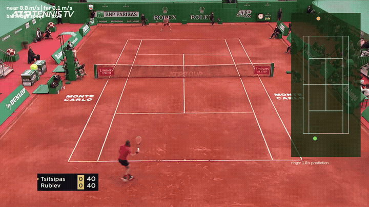
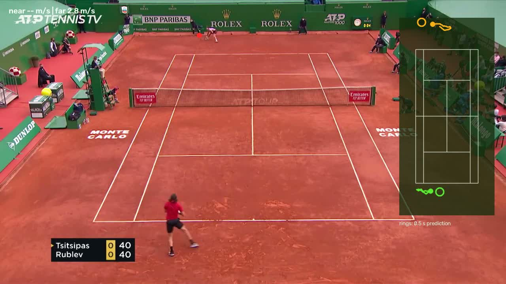
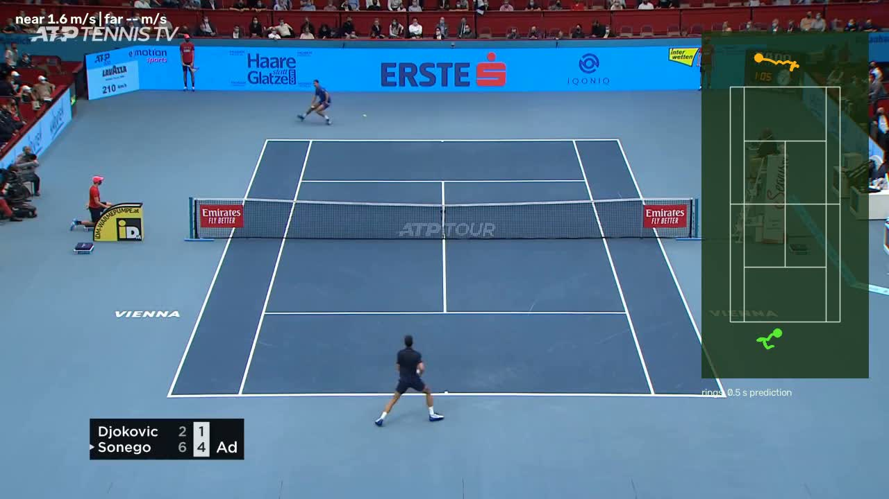

# Tennis Movement Analyzer

> **Vision-to-Kinematics:** Robust court homography calibration, multi-player tracking, and 1.0-second future trajectory prediction from monocular broadcast video.



GPU-accelerated broadcast-tennis pipeline that maps standard 2D television broadcast frames into a canonical top-down metric court, causally tracks player foot positions, and uses regularized residual regression to predict player movement 1.0 second ahead.

Start with [`CODE_GUIDE.md`](CODE_GUIDE.md) for data flow, file map, database layout, and training options.

## Fastest path to a finished demo

Use Python 3.11 or newer with a CUDA-enabled PyTorch installation when possible. This
checkout has also been smoke-tested with Python 3.14 on CPU. Put a wide-court singles
video in `data/`, then run:

```bash
python -m court_detector.movement_analyzer all \
  --input data/match.mp4 \
  --output-video outputs/match_annotated.mp4 \
  --max-frames 1800
```

The equivalent shortcut for the included sample is `make demo`.
`python -m court_detector` is also a short alias for the movement-analyzer CLI.

That one command:

1. extracts near-player feet, far-player feet, and ball image coordinates;
2. stores coordinates and quality flags in `outputs/movement.sqlite` (no frames);
3. rejects implausible jumps and fills only short gaps using past observations;
4. trains a small ridge model to predict both players 1.0 second ahead; and
5. writes `outputs/movement_report.html`, `outputs/movement.csv`, and a prediction video.

The bundled ball checkpoint is useful for a demo but comes from an upstream repository
without an explicit license. See `models/README.md`. Add `--no-ball` if it performs poorly
on a video or you want faster extraction.

On a CPU-only machine, extract players first and add ball coordinates later without
rerunning court or pose detection:

```bash
python -m court_detector.movement_analyzer extract \
  --input data/match.mp4 --no-ball
python -m court_detector.movement_analyzer backfill-ball --video-id 1
python -m court_detector.movement_analyzer train
python -m court_detector.movement_analyzer report
```

The default movement model uses player positions only because that performed slightly
better on the included held-out clip. To repeat the optional ball-feature experiment, use
`train --use-ball-features`; ball coordinates are still rendered and used for ball speed.

Useful inspection/export commands:

```bash
python -m court_detector.movement_analyzer summary
python -m court_detector.movement_analyzer predict
python -m court_detector.movement_analyzer export --output outputs/movement.csv
```

For quick setup verification, use at least 300 frames. For a train/validation split,
use a few minutes of wide-court footage. Multiple videos are preferable: the last video
becomes a held-out validation source. With only one video, training uses a chronological
80/20 split.

Player speeds are reported in approximate meters/second because foot coordinates lie on
the court plane. Ball speed is reported in pixels/second; broadcast video cannot recover
true 3D ball speed from a single camera without stronger calibration.

## Current behavior

- Detects 14 court landmarks and validates candidate homographies against all
  visible points before accepting them.
- Smooths projected court geometry, rebuilds a consistent homography from the
  smoothed points, detects camera cuts, and briefly reuses only recent valid
  geometry when inference fails.
- Runs YOLO pose at 1280 px, projects confidence-aware ankle/bbox foot points to
  court space, and selects exactly one tracked player per court half.
- Uses a higher-resolution court-guided far-half crop when a tiny far player is
  missed or the only candidate is peripheral, and smooths track state so one
  torso-only pose cannot cause a multi-frame identity loss.
- Stores frame, homography, bounding box, player feet, and court-plane
  coordinates directly into a lightweight, serverless SQLite database.
- Renders minimap tracking trails, player speeds, and 1.0s trajectory predictions.

| Monte Carlo (Clay Court) | Vienna Open (Hard Court) |
|:---:|:---:|
|  |  |

Measured checks on demo media:

- Three supplied still images: 14/14 homography inliers, ~2.8–4.7 px median landmark error, correct near/far selection despite 6–12 people in view.
- Australian Open wide-court rally (170 frames): 100% far-player and 99.4% near-player coverage.
- Full 3,099-frame Australian Open source: 21.8 processing FPS without video encoding; 100% far-player and 99.96% near-player coverage across accepted wide-court frames.
- Vienna Open & Monte Carlo rallies: consistent court homography across clay and hard courts.

## Setup

Recommended: Python 3.10+ with PyTorch.

```bash
python -m venv .venv
source .venv/bin/activate
pip install -r requirements-dev.txt
```

## Running the Pipeline

Extract, clean, train future position predictions, and generate reports in one command:

```bash
python -m court_detector all --input data/match.mp4 --output-video outputs/match_annotated.mp4
```

Or step-by-step:

```bash
# 1. Extract coordinates to SQLite
python -m court_detector extract --input data/match.mp4 --no-ball

# 2. Train future position predictor
python -m court_detector train

# 3. Generate HTML dashboard report
python -m court_detector report --output outputs/movement_report.html

# 4. Render video with minimap & prediction rings
python -m court_detector render --video-id 1 --output outputs/predictions.mp4
```

## Results & Benchmarks

Evaluated on held-out broadcast rallies (**1,566 training windows** across 8 matches; **145 validation windows** held out on an unseen grass-court match):

| Metric | Constant-Velocity Baseline | Ridge Residual Model | Improvement |
|---|---|---|---|
| **Mean Absolute Error (MAE)** | 1.909 m | **1.520 m** | **+20.3%** |
| **Median Error** | — | 1.463 m | — |
| **90th Percentile Error** | — | 2.574 m | — |
| **Near-Player Error** | 1.921 m | 1.343 m | +30.1% |
| **Far-Player Error** | 1.896 m | 1.698 m | +10.4% |
| **Dataset Scale** | — | 3,075 frames (9 videos) | Multi-surface (Clay/Hard/Grass) |

### Horizon Scaling

As the forecast horizon expands, straight-line physics baselines diverge because tennis players decelerate and recover toward the center of the court. The regularized residual model captures this geometry:

| Forecast Horizon | Constant-Velocity MAE | Model MAE | Improvement over Physics |
|---|---|---|---|
| **0.5 seconds** | 0.962 m | **0.817 m** | +15.1% |
| **1.0 second (Default)** | 2.521 m | **1.922 m** | **+23.8%** |
| **1.5 seconds** | 4.213 m | **3.148 m** | +25.3% |
| **2.0 seconds** | 5.549 m | **4.111 m** | +25.9% |

## Verification

```bash
pytest
ruff check court_detector training tests
```

## Project Layout

- `court_detector/` — Court landmark geometry, homography, YOLO pose player tracking, TrackNet ball tracker, SQLite storage, and video rendering.
- `training/` — Movement model training (`train_movement.py`) and TrackNet fine-tuning (`train_ball.py`).
- `outputs/` — Generated demo videos, predictions, HTML dashboard reports, and SQLite database.
- `models/` — Pretrained weights for court landmarks, YOLOv8 pose, and TrackNet ball tracking.
- `tests/` — Homography estimation, player tracking, and end-to-end movement pipeline tests.
